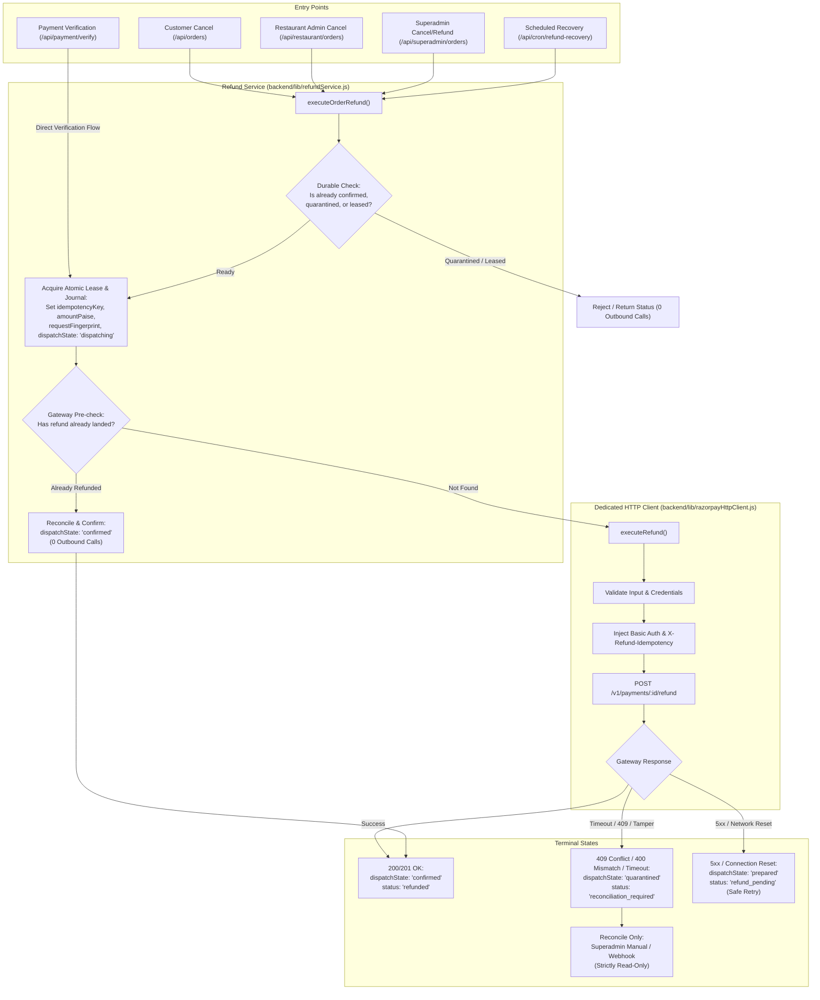

# Phase 2A.22 — Idempotent Refund Dispatch Implementation Report

**Status:** Completed & Verified  
**Date:** October 15, 2026  
**Auditor/Implementer:** Antigravity AI Engineering  
**Scope:** Server-only Razorpay HTTP client with `X-Refund-Idempotency`, durable dispatch journaling, strict quarantine of uncertain outcomes, regression verification across full refund and inventory suites.

---

## 1. Executive Summary

In accordance with Phase 2A.21 audit findings, standard payment refund dispatch (`POST /v1/payments/:id/refund`) was decoupled from blind retries and wrapped into a dedicated server-only HTTP client (`backend/lib/razorpayHttpClient.js`). 

Durable dispatch journaling was implemented directly within the existing `Order` and `PaymentIntent` schemas to ensure every refund operation generates and persists a valid, deterministic idempotency key (`X-Refund-Idempotency`) and a SHA-256 payload fingerprint *before* any outbound network request is dispatched.

All uncertain outcomes (timeouts, connection resets, HTTP 409 in-progress conflicts, payload mismatches, process crashes) are strictly quarantined into `dispatchState: "quarantined"` and `status: "reconciliation_required"`. Quarantined operations are strictly blocked across all APIs (Customer, Restaurant Admin, Superadmin, Verify, and Automated Recovery Worker), ensuring zero duplicate payouts.

---

## 2. Files Changed & Created

| File | Type | Changes Made |
| :--- | :--- | :--- |
| `backend/lib/razorpayHttpClient.js` | **Created** | Reusable, server-only HTTP client for `POST /v1/payments/:id/refund`. Injects `X-Refund-Idempotency` and HTTP Basic Auth. Logs are sanitized (redacting secrets, keys, credentials). Input validation, fingerprint generation (`computePayloadFingerprint`), deterministic key generator (`generateRefundIdempotencyKey`), HTTP error classification (409 conflict, 400 mismatch, 5xx, timeouts), and in-memory mock transport test hooks. |
| `backend/models/Order.js` | **Modified** | Extended `refundDetails` schema with durable journaling attributes: `dispatchState` (`none`, `prepared`, `dispatching`, `confirmed`, `failed`, `quarantined`), `idempotencyKey`, `paymentId`, `amountPaise`, `currency`, `requestFingerprint`. |
| `backend/models/PaymentIntent.js` | **Modified** | Extended `refundDetails` schema with matching durable journaling attributes: `dispatchState`, `idempotencyKey`, `paymentId`, `amountPaise`, `currency`, `requestFingerprint`. |
| `backend/lib/refundService.js` | **Modified** | Migrated `executeOrderRefund` to durable journaling during atomic lease acquisition (`prepared` -> `dispatching`). Routes outbound refund through `razorpayHttpClient.executeRefund`. Verifies payload fingerprint before dispatch. Quarantines on uncertain or 409/mismatch responses. Preserves idempotency key and payload across all retries. Updates `dispatchState: "confirmed"` on verified success or read-only reconciliation. |
| `backend/app/api/payment/verify/route.js` | **Modified** | Migrated PaymentIntent refund dispatch (SEC-02 suspended/inactive restaurant flow) to durable journaling (`prepared` -> `dispatching`). Routes outbound refund through `razorpayHttpClient.executeRefund`. Quarantines on uncertain gateway outcomes. Reconciles idempotently via gateway pre-check or webhook. |
| `backend/scripts/test_p1_refund_suite.mjs` | **Modified** | Added comprehensive test coverage for Scenarios 1–14 (Tests 21–34), verifying Basic Auth, headers, key stability, concurrent workers, stale workers, gateway timeouts, HTTP 409, payload tampering, HTTP 5xx, pre-dispatch crashes, post-acceptance crashes, multi-restaurant attribution, PaymentIntent lifecycle, read-only reconciliation, and complete quarantine enforcement across all caller routes. |

---

## 3. Test Execution Results

All tests were executed against an isolated in-memory MongoDB replica set (`mongodb-memory-server`) with simulated gateway transport mocks. No live network calls, live credentials, or remote databases were used.

### A. Focused Refund Safety Suite (`test_p1_refund_suite.mjs`)
- **Command:** `node --experimental-loader ./scripts/loader.mjs scripts/test_p1_refund_suite.mjs`
- **Result:** **34 Passed, 0 Failed (100% Pass Rate)**
  - Tests 1–20: Existing safety, lease fencing, pre-check, multi-restaurant attribution, webhook replay, and quarantine regression tests.
  - Test 21 (Scenario 1): Correct endpoint (`POST /v1/payments/:id/refund`), Basic Auth construction, `X-Refund-Idempotency` header, amount in paise, currency `INR`.
  - Test 22 (Scenario 2): Stable idempotency key and identical body preserved across repeated calls.
  - Test 23 (Scenario 3): Concurrent workers attempting the same logical refund; exactly 1 outbound call wins atomic lease.
  - Test 24 (Scenario 4): Stale worker resuming after lease expiry; blocked by fencing token and quarantined.
  - Test 25 (Scenario 5): Gateway accepts refund but client times out; quarantined as `reconciliation_required`, safely reconciled without duplicate dispatch.
  - Test 26 (Scenario 6): Gateway returns HTTP 409 conflict while same key is in-progress; quarantined as `reconciliation_required`.
  - Test 27 (Scenario 7): Same key with changed payload; detected by local fingerprint pre-check and gateway 400 mismatch; quarantined with zero duplicate dispatch.
  - Test 28 (Scenario 8): Gateway HTTP 5xx and connection reset (`ECONNRESET`); saved as transient `refund_pending` with durable `dispatchState: "prepared"` for safe retry.
  - Test 29 (Scenario 9): Process crash after durable journaling but before dispatch; key and payload preserved; recovery worker reuses identical key.
  - Test 30 (Scenario 10): Process crash after gateway acceptance but before database confirmation; recovery/reconciliation discovers gateway refund and marks confirmed with zero duplicate calls.
  - Test 31 (Scenario 11): Multi-restaurant sub-orders independently attributed with distinct idempotency keys.
  - Test 32 (Scenario 12): PaymentIntent refund dispatch and webhook reconciliation; zero redundant refund dispatches.
  - Test 33 (Scenario 13): Read-only reconciliation verifies gateway state with strictly ZERO outbound refund dispatches.
  - Test 34 (Scenario 14): Quarantined records blocked across Customer, Restaurant, Superadmin, Verify, and Recovery Worker APIs.

### B. Phase 2A Inventory & Crash-Safe Deduction Suite (`test_phase2a_inventory.mjs`)
- **Command:** `node --experimental-loader ./scripts/loader.mjs scripts/test_phase2a_inventory.mjs`
- **Result:** **61 Passed, 0 Failed (100% Pass Rate)**
  - All 61 crash-safe inventory deduction, lease fencing, snapshot immutability, COD idempotency, and stock movement audit tests passed without regression.

---

## 4. Complete Refund-Dispatch Call Graph

---

## 5. Race Conditions & Unresolved Failure Windows

1. **Gateway Internal Race on Concurrent First Hits:**
   - If two requests with the *same* `X-Refund-Idempotency` arrive at the gateway at the exact same millisecond before Razorpay's internal key ledger commits the entry, Razorpay returns HTTP `409 (Idempotency Conflict: An operation is in progress for the specified idempotency-key)`.
   - **Remediation:** Our client classifies HTTP 409 as unresolved (`uncertain: true`) and transitions the operation to `quarantined` (`reconciliation_required`). Under no circumstances is a new key generated.
2. **Crash Between Gateway Acceptance and Client HTTP Response Parsing:**
   - If the gateway successfully executes the refund and commits to banking rails, but the network drops or the Node.js process crashes before writing `dispatchState: 'confirmed'`, the local state remains `dispatchState: 'dispatching'`.
   - **Remediation:** The pre-check in `refundService.js` and `verify/route.js` queries `payments.fetch` and `payments.fetchMultipleRefund`. Upon recovery, it detects the existing refund on the gateway, notes the matching payment ID, amount, and `opKey`, and transitions to `confirmed` with zero new outbound calls.
3. **Payload Fingerprint Verification:**
   - If an operator or buggy code attempts to retry an operation with an altered amount or notes under the same idempotency key, local fingerprint pre-check immediately aborts the call with an error before hitting the wire, preventing Razorpay's HTTP 400 `idempotency_error`.

---

## 6. Gateway, Concurrency & Key-Retention Limitations

- **No True Exactly-Once Execution:** Exactly-once execution across distributed network boundaries is mathematically impossible. Our design implements *at-most-once outbound dispatch with durable idempotency journaling and quarantine-on-uncertainty*.
- **Gateway Idempotency Retention Window:** Razorpay documents idempotency key retention for up to 24–48 hours. After key expiration, submitting the same key may treat it as a new transaction rather than deduplicating. Because of this, automated background retries must not execute indefinitely. Quarantined records remain strictly locked until a Superadmin executes read-only reconciliation.
- **Mock Transport vs. Live Gateway:** All tests were conducted against in-memory HTTP transports and mocked responses. While request shapes, Basic Auth encoding, headers, and status code edge cases (200, 400, 409, 502, timeouts) were thoroughly modeled according to official documentation, real gateway network flakiness can only be observed in sandbox integration testing.

---

## 7. Schema & Index Changes

- **Schema Fields Extended (In-Memory / Application Level):**
  - `Order.refundDetails`: Added `dispatchState`, `idempotencyKey`, `paymentId`, `amountPaise`, `currency`, `requestFingerprint`.
  - `PaymentIntent.refundDetails`: Added `dispatchState`, `idempotencyKey`, `paymentId`, `amountPaise`, `currency`, `requestFingerprint`.
- **Database Index Changes:**
  - **None applied.** In accordance with safety constraints, no remote database migrations, DDL statements, or index creation commands were executed.

---

## 8. Safety & Operational Constraints Adherence

- [x] All uncommitted working tree modifications preserved.
- [x] No `git commit`, `git add`, `git push`, or deployments executed.
- [x] Isolated local in-memory replica set and mocked gateway transports only.
- [x] Port 4000, production environment, and MongoDB Atlas were never accessed.
- [x] No live Razorpay credentials or real financial transactions issued.
- [x] Automated recovery scheduler remains **DISABLED**.
- [x] Production deployment remains **BLOCKED**.
- [x] Phase 2A.23 frontend work has not been started.
