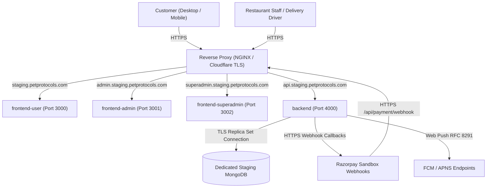
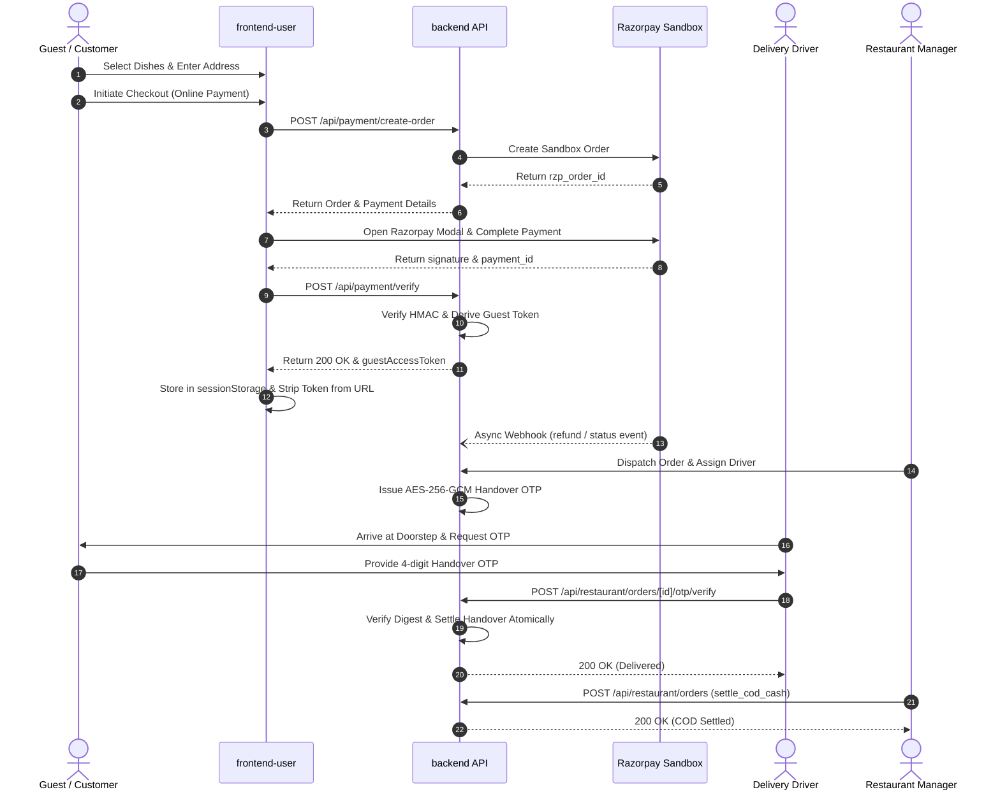

# पेट Protocols — Staging Validation & Production Readiness Runbook

**Document Version:** 1.0.0  
**Effective Date:** 2026-10-25  
**Author:** Principal Software Architect, Application Security Engineer, QA Automation Lead, DevOps Engineer, Payment Integration Specialist  
**Repository Worktree:** `D:\Summer Work\pet-protocols-gemini.worktrees\pet-protocols-frontend-backend-split`  
**Git Branch:** `main` (Audited read-only; 59 tracked modifications and 36 untracked files preserved)

---

## 1. Objective & Operational Scope

This runbook provides a **safe, repeatable, evidence-driven execution guide** for taking the hardened Pet Protocols platform through live staging validation. It establishes:
1. The exact deployment pattern and build procedures for the 4 monorepo sub-applications.
2. A verified environment variable checklist, resolving code vs. documentation discrepancies.
3. A complete cryptographic key-rotation analysis for Delivery OTPs and Guest Access Tokens.
4. Step-by-step test modules covering registered/guest checkout, live Razorpay sandbox integration, staff role boundaries, OTP delivery, server-authoritative COD settlement, Web Push, and mobile compatibility.
5. Standardized evidence capture, sanitization rules, cleanup workflows, and emergency rollback procedures.

> [!IMPORTANT]
> **Safety Guardrails**: Never execute destructive database commands, modify production data, use real payment instruments, or log plaintext secrets, tokens, or OTP codes.

---

## 2. Deployment Platform & Staging Architecture

### Monorepo Structure & Package Manifest Analysis
The repository is structured as an npm monorepo with 4 distinct Next.js 16.0.7 (React 19) applications:
- **`backend`**: Node.js/Next.js API server handling business logic, MongoDB persistence, NextAuth token verification, Razorpay integration, Web Push, and role authorization.
  - Build: `npm run build --prefix backend` (`next build`)
  - Run: `npm run start --prefix backend` (`next start -p 4000`)
- **`frontend-user`**: Customer-facing ordering interface (Menu, Cart, Checkout, Order Confirmation, History, Tracking).
  - Build: `npm run build --prefix frontend-user` (`next build`)
  - Run: `npm run start --prefix frontend-user` (`next start -p 3000`)
- **`frontend-admin`**: Restaurant staff workspaces (Kitchen, Cashier, Delivery Staff, Restaurant Manager).
  - Build: `npm run build --prefix frontend-admin` (`next build`)
  - Run: `npm run start --prefix frontend-admin` (`next start -p 3001`)
- **`frontend-superadmin`**: Platform administrator interface (Restaurant Onboarding, Global Offers, System Controls).
  - Build: `npm run build --prefix frontend-superadmin` (`next build`)
  - Run: `npm run start --prefix frontend-superadmin` (`next start -p 3002`)

### Recommended Staging Deployment Architecture
The safest and most isolated deployment model for this monorepo build is a **Dedicated Linux Staging Host (or Container Cluster)** fronted by an **NGINX / Cloudflare Reverse Proxy**:



### Staging Build & Execution Procedure
```bash
# 1. Clean install all workspace dependencies
npm run install:all

# 2. Build all four Next.js applications in production mode
npm run build:all

# 3. Start applications with PM2 or systemd process supervisor
pm2 start npm --name "staging-backend" -- run start:backend
pm2 start npm --name "staging-user" -- run start:user
pm2 start npm --name "staging-admin" -- run start:admin
pm2 start npm --name "staging-superadmin" -- run start:superadmin
```

---

## 3. Staging Environment Checklist & Variable Validation

### Verified Environment Variables vs. Code Implementation

| Application | Environment Variable Name | Type / Format | Exposure | Implementation Source & Validation Rule |
| :--- | :--- | :--- | :--- | :--- |
| **backend** | `MONGODB_URI` | MongoDB Connection URI | Server Only | [`backend/lib/db.js`](file:///d:/Summer%20Work/pet-protocols-gemini.worktrees/pet-protocols-frontend-backend-split/backend/lib/db.js). Must point to dedicated staging replica set with TLS. |
| **backend** | `NEXTAUTH_SECRET` | 32+ char CSPRNG string | Server Only | [`backend/lib/auth.js`](file:///d:/Summer%20Work/pet-protocols-gemini.worktrees/pet-protocols-frontend-backend-split/backend/lib/auth.js). Encrypts NextAuth JWTs. Must match frontends. |
| **backend** | `DELIVERY_OTP_SECRET` | Exactly 64 hex characters (32 bytes) | Server Only | [`backend/lib/deliveryOtpService.js`](file:///d:/Summer%20Work/pet-protocols-gemini.worktrees/pet-protocols-frontend-backend-split/backend/lib/deliveryOtpService.js#L26-L52). Fails closed in staging/prod if missing. |
| **backend** | `GUEST_ACCESS_SECRET` | 32+ char high-entropy string | Server Only | [`backend/lib/guestAccessService.js`](file:///d:/Summer%20Work/pet-protocols-gemini.worktrees/pet-protocols-frontend-backend-split/backend/lib/guestAccessService.js#L110-L137). Master key for HKDF token derivation. Fails closed. |
| **backend** | `RAZORPAY_KEY_ID` | String (`rzp_test_*`) | Server Only | [`backend/app/api/payment/verify/route.js`](file:///d:/Summer%20Work/pet-protocols-gemini.worktrees/pet-protocols-frontend-backend-split/backend/app/api/payment/verify/route.js). Must be Razorpay Sandbox key. |
| **backend** | `RAZORPAY_KEY_SECRET` | High-entropy string | Server Only | [`backend/app/api/payment/verify/route.js`](file:///d:/Summer%20Work/pet-protocols-gemini.worktrees/pet-protocols-frontend-backend-split/backend/app/api/payment/verify/route.js). Used for HMAC-SHA256 signature verification. |
| **backend** | `RAZORPAY_WEBHOOK_SECRET` | High-entropy string | Server Only | [`backend/app/api/payment/webhook/route.js`](file:///d:/Summer%20Work/pet-protocols-gemini.worktrees/pet-protocols-frontend-backend-split/backend/app/api/payment/webhook/route.js#L25-L28). Dedicated webhook secret from Razorpay Dashboard. |
| **backend** | `NEXT_PUBLIC_VAPID_PUBLIC_KEY` | Base64 URL-safe string | Client/Server | [`backend/lib/pushService.js`](file:///d:/Summer%20Work/pet-protocols-gemini.worktrees/pet-protocols-frontend-backend-split/backend/lib/pushService.js#L10). VAPID public key. |
| **backend** | `VAPID_PRIVATE_KEY` | Base64 URL-safe string | Server Only | [`backend/lib/pushService.js`](file:///d:/Summer%20Work/pet-protocols-gemini.worktrees/pet-protocols-frontend-backend-split/backend/lib/pushService.js#L11). VAPID private signing key. |
| **backend** | `VAPID_SUBJECT` | `mailto:...` or URL | Server Only | [`backend/lib/pushService.js`](file:///d:/Summer%20Work/pet-protocols-gemini.worktrees/pet-protocols-frontend-backend-split/backend/lib/pushService.js#L12). RFC 8292 contact claim. |
| **backend** | `FRONTEND_URL` | HTTPS URL | Server Only | Base URL for customer frontend (`https://staging.petprotocols.com`). |
| **backend** | `ADMIN_URL` | HTTPS URL | Server Only | Base URL for staff admin frontend (`https://admin.staging.petprotocols.com`). |
| **frontend-user** | `BACKEND_INTERNAL_URL` | HTTPS or local URL | Server Only | Server-side API proxy destination (`https://api.staging.petprotocols.com`). |
| **frontend-user** | `NEXTAUTH_URL` | HTTPS URL | Server/Client | Canonical origin for customer authentication (`https://staging.petprotocols.com`). |
| **frontend-user** | `NEXTAUTH_SECRET` | 32+ char string | Server Only | Matches backend NextAuth secret. |
| **frontend-user** | `NEXT_PUBLIC_RAZORPAY_KEY_ID` | String (`rzp_test_*`) | Client Only | Razorpay Checkout SDK key. |
| **frontend-user** | `NEXT_PUBLIC_VAPID_PUBLIC_KEY` | Base64 string | Client Only | Passed to Service Worker `pushManager.subscribe()`. |
| **frontend-admin**| `BACKEND_INTERNAL_URL` | HTTPS or local URL | Server Only | Server-side API proxy destination. |
| **frontend-admin**| `NEXTAUTH_URL` | HTTPS URL | Server/Client | Canonical origin for admin authentication (`https://admin.staging.petprotocols.com`). |
| **frontend-super**| `NEXTAUTH_URL` | HTTPS URL | Server/Client | Canonical origin for superadmin authentication. |

### Code vs. Documentation Inconsistencies Flagged
1. **`VAPID_PUBLIC_KEY` vs. `NEXT_PUBLIC_VAPID_PUBLIC_KEY`**:
   - `backend/.env.example` lists `VAPID_PUBLIC_KEY`, while `frontend-user/.env.example` lists `NEXT_PUBLIC_VAPID_PUBLIC_KEY`.
   - `backend/lib/pushService.js` line 10 supports both: `process.env.NEXT_PUBLIC_VAPID_PUBLIC_KEY || process.env.VAPID_PUBLIC_KEY`.
   - **Resolution**: Use `NEXT_PUBLIC_VAPID_PUBLIC_KEY` uniformly across backend and frontends to eliminate ambiguity.
2. **`DELIVERY_OTP_HMAC_SECRET` in Legacy Scripts**:
   - Older scripts (`test_e2e_order_workflow.mjs`) reference `DELIVERY_OTP_HMAC_SECRET`.
   - The authoritative production implementation in `deliveryOtpService.js` strictly requires `DELIVERY_OTP_SECRET` (64 hex characters) and derives `hmacKey` and `aesKey` via HKDF.
   - **Resolution**: Deprecate `DELIVERY_OTP_HMAC_SECRET`. Do not configure it in staging.
3. **Razorpay Webhook Secret Fallback**:
   - In `backend/app/api/payment/webhook/route.js` line 27: `return process.env.RAZORPAY_WEBHOOK_SECRET || process.env.RAZORPAY_KEY_SECRET || null;`.
   - While falling back to `RAZORPAY_KEY_SECRET` works in local development, Razorpay best practice requires a distinct webhook secret created in the Razorpay Webhooks Dashboard.
   - **Resolution**: Staging must set a dedicated `RAZORPAY_WEBHOOK_SECRET`.

---

## 4. Key-Rotation Analysis: Impact & Recovery Procedures

### A. Delivery OTP Secret Rotation (`DELIVERY_OTP_SECRET`)
- **Master Secret Function**: Generates sub-keys for AES-256-GCM encryption of stored OTP codes (`aesKey`) and HMAC-SHA-256 verification digests (`hmacKey`).
- **What Rotation Invalidates**:
  - All active, in-flight OTPs currently in `out_for_delivery` state. Decryption of existing `encryptedCode` fails authentication tag verification (`decryptOtpCode` returns `null`), and verification of existing digests fails.
- **What Remains Valid**:
  - All historical orders with `status: "delivered"` remain permanently valid. Completed orders do not re-verify OTP digests.
- **How Active Deliveries Recover**:
  - The customer or manager triggers code reissuance (`issueDeliveryOtpForOrder(order, { forceRegenerate: true })` or via the UI "Resend Code" button).
  - The system generates a new 4-digit code, encrypts and hashes it with the **new** `DELIVERY_OTP_SECRET`, increments `issuanceId`, and renders the new code immediately.
  - The delivery driver enters the new code and successfully completes handover.

### B. Guest Access Secret Rotation (`GUEST_ACCESS_SECRET`)
- **Master Secret Function**: Used as the HKDF master key for deterministic guest token derivation (`deriveGuestAccessToken`) during payment verification replay.
- **What Rotation Invalidates**:
  - Replay recovery of *lost* tokens for orders created *before* the rotation. If a user previously lost their token and attempts payment replay, the newly derived token will not match the order's existing `tokenHash` in MongoDB.
- **What Remains Valid**:
  - **All active guest browser sessions remain valid!** The MongoDB document stores `guestAccess.tokenHash = SHA256(rawToken)`. Because standard SHA-256 hashing is keyless, any guest token already held in browser `sessionStorage` continues to match and authenticate until its 30-day `expiresAt` timestamp.
- **How Active Orders Recover**:
  - Guests with existing sessions continue uninterrupted.
  - Guests who lost their credentials during a key rotation window can be authenticated via customer support verification or by registering/linking an account.

---

## 5. Step-by-Step Staging Test Runbook



### Module 1: Registered-User & Guest Checkout
- **Objective**: Verify complete order creation for both registered accounts and unauthenticated guests, ensuring immediate URL sanitization and `sessionStorage` token isolation.
- **Preconditions**: Staging database seeded with active restaurants and dishes.
- **Steps**:
  1. Open desktop browser in Incognito mode. Navigate to `https://staging.petprotocols.com/menu?restaurant=<REST_ID>`.
  2. Add items to cart. Navigate to `/checkout`.
  3. Fill in guest name, phone (`9876543210`), and address. Select "Cash on Delivery". Click "Place Order".
  4. Observe redirection to `/order-confirmation?orderId=<ID>&guestToken=gst_...`.
  5. Inspect browser URL bar immediately after load.
  6. Inspect `sessionStorage` via DevTools: `sessionStorage.getItem('pet_protocols_guest_token_<ID>')`.
  7. Refresh the browser page (`F5`).
- **Expected Results**:
  - Order creates with status `pending`.
  - URL sanitizes within 500ms: `guestToken` and `guestAccessToken` are removed; `orderId` is retained.
  - `sessionStorage` holds `gst_*` token. Page reload successfully fetches order details without 401/404 error.
- **Evidence to Capture**: Sanitized URL string, redacted `sessionStorage` key presence (`gst_****`), order ID.
- **Criteria**: **PASS** if sanitized and persists; **FAIL** if token remains in URL or reload fails.

---

### Module 2: Razorpay Sandbox Payment & Live Webhook Delivery
- **Objective**: Execute authentic payment authorization against Razorpay Sandbox using test instruments and verify live webhook receipt.
- **Preconditions**: `RAZORPAY_KEY_ID` configured with `rzp_test_*`; public webhook URL registered in Razorpay Dashboard.
- **Steps**:
  1. Add dishes to cart. Select "Online Payment (Razorpay)".
  2. In the Razorpay modal, select "Card" and use Razorpay Sandbox test card (`4111 1111 1111 1111`, CVV `123`, Future Date).
  3. Enter Sandbox OTP `1234` and click "Success".
  4. Verify modal closes, browser verifies payment via `POST /api/payment/verify`, and redirects to `/order-confirmation`.
  5. Check Razorpay Dashboard -> Webhooks -> Recent Deliveries for webhook delivery to `https://api.staging.petprotocols.com/api/payment/webhook`.
- **Expected Results**:
  - `PaymentIntent` status transitions from `created` -> `verifying` -> `verified`.
  - `Order` created with `paymentStatus: "paid"`.
  - Webhook delivery returns HTTP 200 with `{ success: true }`.
- **Evidence to Capture**: Razorpay Payment ID (`pay_test_*`), Razorpay Order ID (`order_test_*`), Webhook delivery ID.
- **Criteria**: **PASS** if payment verifies server-authoritatively and webhook succeeds; **FAIL** if payment status mismatches.

---

### Module 3: Duplicate Webhooks & Payment-Verification Retries
- **Objective**: Validate idempotent handling of duplicated client verification calls and repeated webhook deliveries.
- **Steps**:
  1. Take the verified `razorpay_order_id`, `razorpay_payment_id`, and `razorpay_signature` from Module 2.
  2. Send a duplicate `POST /api/payment/verify` request using `curl`:
     ```bash
     curl -i -X POST https://api.staging.petprotocols.com/api/payment/verify \
       -H "Content-Type: application/json" \
       -d '{"razorpay_order_id":"<RZP_ORD>","razorpay_payment_id":"<RZP_PAY>","razorpay_signature":"<SIG>"}'
     ```
  3. In the Razorpay Dashboard, click "Resend" on the webhook delivery.
  4. Query the staging database for orders matching `paymentId: <RZP_PAY>`.
- **Expected Results**:
  - Replay verification returns HTTP `200 OK` (not 201) with the exact same `guestAccessToken`.
  - Resent webhook returns HTTP 200 without creating duplicate refunds or status transitions.
  - Exactly 1 order document exists in MongoDB. Zero duplicates.
- **Evidence to Capture**: HTTP response status codes, MongoDB order count (`count === 1`).
- **Criteria**: **PASS** if idempotent; **FAIL** if duplicate order or token mismatch occurs.

---

### Module 4: Restaurant Staff Role Permissions
- **Objective**: Enforce strict least-privilege role boundaries across Kitchen, Cashier, Delivery, and Manager roles.
- **Preconditions**: Four staging accounts seeded: Manager, Kitchen, Cashier, Delivery Staff.
- **Steps**:
  1. Log in as Kitchen Staff (`kitchen@staging.petprotocols.com`). Attempt to dispatch an order via `PUT /api/restaurant/orders` with `status: "out_for_delivery"`.
  2. Log in as Cashier (`cashier@staging.petprotocols.com`). Attempt to verify a delivery handover OTP.
  3. Log in as Delivery Driver (`driver@staging.petprotocols.com`). Attempt to access an order assigned to a different driver or different restaurant branch.
  4. Log in as Restaurant Manager (`manager@staging.petprotocols.com`). Assign the delivery order to driver and dispatch.
- **Expected Results**:
  - Kitchen dispatch attempt: **HTTP 403 Forbidden**.
  - Cashier OTP attempt: **HTTP 403 Forbidden**.
  - Cross-driver / cross-restaurant access: **HTTP 403 / 404 Access Denied**.
  - Manager assignment and dispatch: **HTTP 200 OK**.
- **Evidence to Capture**: HTTP response codes and error message bodies.
- **Criteria**: **PASS** if all unauthorized actions are blocked; **FAIL** if any role boundary leaks.

---

### Module 5: Delivery OTP Handover & COD Financial Settlement
- **Objective**: Verify secure issuance, customer retrieval, 5-attempt rate-limiting, atomic driver verification, and manager COD cash settlement.
- **Steps**:
  1. Place a delivery COD order. As Manager, assign driver Raj and dispatch to `out_for_delivery`.
  2. Retrieve OTP as customer via `GET /api/orders/<ID>/handover-otp` with `x-guest-access-token`. Confirm 4-digit code.
  3. As Driver, submit incorrect code `0000` via `POST /api/restaurant/orders/<ID>/otp/verify`.
  4. Repeat incorrect code 4 more times (5 total). Verify HTTP 429 / Lockout.
  5. Customer requests reissuance via UI after 60s cooldown. Verify new 4-digit code issued.
  6. Driver submits correct new code and passes `{ collectedCodCash: 250 }`.
  7. Confirm order status transitions to `delivered` with `codReceipt.collected: true, settledWithManager: false`.
  8. As Manager, submit `PUT /api/restaurant/orders` with action `settle_cod_cash`.
- **Expected Results**:
  - Max attempts lock out compromised code.
  - Reissued code succeeds; handover marks order delivered atomically.
  - Driver cannot self-settle cash with manager; Manager action completes COD settlement (`settledWithManager: true`).
- **Evidence to Capture**: Lockout response, handover response, settlement timestamp.
- **Criteria**: **PASS** if full lifecycle executes atomically; **FAIL** if settlement occurs prematurely.

---

### Module 6: Real Web Push Notification Validation
- **Objective**: Verify live Web Push delivery to browser clients upon delivery status transitions.
- **Preconditions**: Staging VAPID keys configured; browser notification permission granted on test client.
- **Steps**:
  1. Open Customer app on desktop or Android. Click "Enable Notifications".
  2. Verify subscription document created in staging MongoDB `pushsubscriptions` collection.
  3. Transition order to `out_for_delivery` and then `delivered`.
  4. Observe OS notification banner on test device.
  5. Inspect notification payload: confirm absence of sensitive tokens, OTPs, or customer passwords.
- **Expected Results**:
  - Push notification appears on device with order status text.
  - Failed push deliveries (e.g. invalid endpoint) log non-blocking warning without reverting order state.
- **Evidence to Capture**: Screenshot of device notification banner, MongoDB subscription ID.
- **Criteria**: **PASS** if push delivers on real device; **BLOCKED** if VAPID keys unconfigured.

---

### Module 7: Mobile & Physical Device Testing
- **Objective**: Test responsive touch layout, live delivery map, and Safari Private Browsing `sessionStorage` behavior.
- **Devices**: Physical iPhone (iOS 17/18 Safari) and Physical Android device (Chrome).
- **Steps**:
  1. Open Safari on iPhone in **Private Browsing Mode**.
  2. Complete guest COD checkout. Verify redirect to `/order-confirmation`.
  3. Verify URL sanitization removes tokens without breaking page layout.
  4. Test page refresh (`F5`). Verify order details load from `sessionStorage`.
  5. Test backgrounding browser and returning 5 minutes later.
  6. On Android device, verify responsive bottom navigation and touch cart drawer.
- **Expected Results**:
  - iOS Private Browsing retains `sessionStorage` for the tab lifecycle.
  - Cart drawer and live map render without viewport overflow.
- **Evidence to Capture**: Device OS versions, screen recordings or photos of mobile confirmation screen.
- **Criteria**: **PASS** if touch UI and storage persist; **FAIL** if layout breaks or storage throws fatal error.

---

### Module 8: Order Cancellation, Stale Auto-Dismissal & Recovery
- **Objective**: Validate race-free cancellation, raw vs. prepared food inventory waste accounting, and automated crash recovery.
- **Steps**:
  1. Place an order. Attempt customer self-cancellation while status is `pending`. Verify raw ingredients restocked.
  2. Place second order. Kitchen confirms (`status: "preparing"`). Customer attempts cancellation. Verify cancellation blocked (HTTP 400).
  3. Manager cancels preparing order with waste note. Verify raw ingredients are NOT restocked and waste log is created.
  4. Seed a stale pickup order (`readyAt: 70 minutes ago`). Trigger maintenance worker. Verify order auto-dismisses to `cancelled` with reason `stale_pickup_timeout`.
- **Expected Results**:
  - Pending cancellation restores raw stock.
  - Preparing cancellation prevents customer self-cancel; manager cancellation logs kitchen waste.
  - Stale pickup orders clean up without affecting active `out_for_delivery` orders.
- **Evidence to Capture**: Inventory document stock counts before and after cancellation.
- **Criteria**: **PASS** if inventory and state machine remain strictly consistent; **FAIL** if food is restocked after prep.

---

## 6. Evidence Capture Standards & Sanitization Rules

To ensure complete auditability without violating security standards:
- **Redaction Policy**:
  - Guest tokens must be redacted: `gst_a1b2...****`.
  - Delivery OTP codes must never appear in reports or log aggregators: `OTP: [VERIFIED]`.
  - Passwords, NextAuth secrets, and Razorpay secret keys must be completely masked: `***`.
  - Customer phone numbers: `987654****`.
- **Artifacts to Archive**:
  - NGINX access log snippets showing HTTP status codes.
  - Razorpay Webhook delivery JSON headers (excluding secret header).
  - Cleaned test database snapshot IDs.

---

## 7. Cleanup & Post-Validation Procedures

1. **Test Order Purge**:
   - Staging orders created with prefix `STG_TEST_*` must be marked archived or soft-deleted using the staging cleanup script:
     ```bash
     node backend/scripts/cleanup_staging_test_data.mjs --prefix="STG_TEST_"
     ```
2. **Session Teardown**:
   - Clear browser cookies and `sessionStorage` on test devices.
3. **Database Reset Verification**:
   - Ensure zero production data was touched. Staging database indexes and collection counts verified clean.

---

## 8. Rollback & Emergency Incident Procedures

### Application Rollback
If a fatal defect is discovered during staging validation:
1. Revert NGINX / Cloudflare upstream to the previous stable release container:
   ```bash
   pm2 restart staging-backend-previous
   ```
2. No database migration rollback is required: all schema enhancements (`deliveryOtp`, `guestAccess`, `deliveryAssignmentMode`) are strictly backward-compatible and additive.

### Emergency Secret Revocation
If `GUEST_ACCESS_SECRET` or `DELIVERY_OTP_SECRET` is leaked during staging:
1. Immediately generate replacement secrets:
   ```bash
   export DELIVERY_OTP_SECRET=$(openssl rand -hex 32)
   export GUEST_ACCESS_SECRET=$(openssl rand -base64 32)
   ```
2. Restart the backend process: `pm2 restart staging-backend --update-env`.
3. Invalidate active OTPs and trigger reissuance for legitimate in-flight orders as documented in Section 4.

---

## 9. Prerequisites Requiring User Action & Next Steps

To begin staging execution, provide or complete the following items:

1. **Staging Database Target**:
   - Provide the dedicated Staging MongoDB connection URI (must not connect to local or production Atlas).
2. **Staging Domain / Host Provisioning**:
   - Provide the staging server SSH / deployment target or confirm local multi-port deployment on HTTPS reverse proxy.
3. **Razorpay Sandbox Credentials**:
   - Provide official Razorpay Test Mode Key ID (`rzp_test_*`) and Secret, and configure the webhook URL in the Razorpay Dashboard.
4. **Staging VAPID Keypair**:
   - Confirm generation of staging VAPID keys for live Web Push testing.
5. **Physical Device Availability**:
   - Confirm availability of physical iPhone and Android devices for Module 7 execution.
